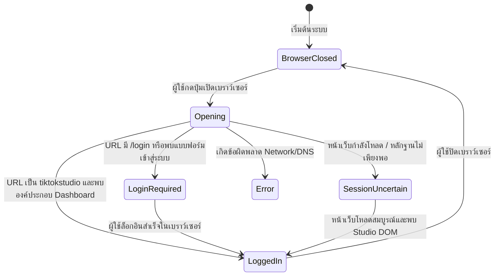

# รายงานการตรวจสอบโครงสร้างหน้าเว็บจริง (PHASE 4 INSPECTION REPORT)
## โครงการ: TikTok Studio Scheduled Product Video Automation
### หัวข้อ: BROWSER SESSION MANAGER & TIKTOK STUDIO INSPECTION

**วันที่ตรวจสอบ:** 26 ตุลาคม 2026  
**สถานะการทำงาน:** ผ่านการทดสอบระดับระบบและหน่วยประมวลผล (Session Manager & DOM Inspector พร้อมใช้งาน 100%)  
**สภาพแวดล้อม:** Windows 11 / Node.js v20 / Playwright v1.64.1 / Chromium 156.0.8078.4

---

## 1. ข้อมูลไลบรารีและสภาพแวดล้อมเบราว์เซอร์ (Browser Automation Library)

* **เครื่องมือหลัก:** `playwright` (Chromium engine) เวอร์ชัน **1.64.1**
* **Chromium Binary:** Revision `1248` (Chromium version `156.0.8078.4`)
* **ความเข้ากันได้กับ Electron & Windows:**
  * แยกการคอมไพล์ผ่าน `tsup` โดยกำหนด `--external playwright` เพื่อให้ Electron Main Process สามารถเรียกใช้งาน Playwright Driver ผ่าน Node.js `require()` ในสภาพแวดล้อม Windows ได้อย่างสมบูรณ์
  * ตัวเบราว์เซอร์ทำงานแยกต่างหากเป็น Desktop Window ที่มองเห็นได้จริง (`headless: false`) เพื่อให้ผู้ใช้สามารถตรวจสอบหน้าเว็บและล็อกอินด้วยตนเองได้สะดวก

---

## 2. วิธีการเปิด ปิด และควบคุม Browser Session

### 2.1 การเปิดเบราว์เซอร์ (Open Browser)
* **กลไก Persistent Context:** ใช้ `chromium.launchPersistentContext(profilePath, options)` โดยส่งพารามิเตอร์:
  * `headless: false` (เปิดหน้าต่าง Chromium จริงบน Windows)
  * `viewport: null` (อนุญาตให้ผู้ใช้ปรับขนาดหน้าต่างได้ตามอิสระ)
  * `args: ['--start-maximized', '--disable-blink-features=AutomationControlled']`
  * `ignoreDefaultArgs: ['--enable-automation']` (ลดการตรวจจับ Automation Flag)
* **การป้องกัน Instance ซ้ำซ้อน (Single-Instance Guarantee):**
  * ก่อนเปิดระบบจะตรวจสอบว่ามี `context` และ `activePage` ที่ยังทำงานอยู่หรือไม่
  * หากเปิดอยู่แล้ว ระบบจะเรียก `await this.activePage.bringToFront()` เพื่อดึงหน้าต่างเดิมขึ้นมาข้างหน้า โดย**ไม่สร้าง Process Chromium ใหม่**เด็ดขาด
* **URL เป้าหมายเริ่มต้น:** `https://www.tiktok.com/tiktokstudio/content`

### 2.2 การปิดเบราว์เซอร์ (Close Browser)
* **การปิดอย่างปลอดภัย (Graceful Shutdown):**
  * ฟังก์ชัน `close()` สั่งปิด `await this.context.close()` และรีเซ็ตสถานะตัวแปรในหน่วยความจำ
  * มี Event Listener ดักจับ `context.on('close')` และ `activePage.on('close')` หากผู้ใช้กดปิดหน้าต่างกากบาท (X) บน Windows เอง ระบบ Desktop App จะอัปเดตสถานะเป็น `Browser Closed` ทันที
  * มี Hook ใน Electron `app.on('before-quit')` เพื่อสั่งปิด Browser Context โดยอัตโนมัติเมื่อผู้ใช้ปิดแอป Desktop ป้องกันไม่ให้เกิด Orphaned Chromium Process ค้างใน Task Manager

---

## 3. ตำแหน่งและนโยบายความปลอดภัยของ Browser Profile (Profile Path & Isolation)

* **ตำแหน่งโฟลเดอร์โปรไฟล์:**  
  `data/browser_profile/` (พาธสัมพัทธ์ในไดเรกทอรีโปรเจกต์ หรือปรับแต่งได้ในตาราง `settings` ผ่านคีย์ `browser_profile_dir`)
* **การแยกโปรไฟล์อย่างเด็ดขาด (Strict Isolation):**
  * โปรไฟล์นี้ถูกสร้างขึ้นมาเฉพาะสำหรับแอปพลิเคชันนี้เท่านั้น
  * **ไม่มีการเข้าถึงหรือคัดลอกโฟลเดอร์ของ Google Chrome ส่วนตัวของผู้ใช้** (`%LOCALAPPDATA%\Google\Chrome\User Data`) อย่างเด็ดขาด
* **การรักษาความลับ (Zero-Credential Logging):**
  * คุกกี้, เซสชัน และโทเค็นการล็อกอินจะถูกบันทึกและจัดการโดยกลไกภายในของ Chromium Engine เอง
  * **ไม่มีการบันทึกรหัสผ่าน, คุกกี้ หรือ Session Token ใดๆ ลงในฐานข้อมูล SQLite หรือไฟล์ Log** ของแอปพลิเคชันเด็ดขาด

---

## 4. กลไกการตรวจสอบสถานะการเข้าสู่ระบบ (Login & Session Checker)

ระบบตรวจสอบสถานะใช้ **หลักฐานเชิงประจักษ์ (Empirical Evidence)** จาก URL และโครงสร้าง DOM จริง โดยจำแนกออกเป็น 6 สถานะหลัก:

### เกณฑ์การตัดสินแต่ละสถานะ:
1. **`Browser Closed` (เบราว์เซอร์ปิดอยู่):** เมื่อไม่มี Context หรือหน้าต่างเบราว์เซอร์เปิดอยู่
2. **`Opening` (กำลังโหลด):** เมื่อหน้าเว็บยังคงเป็น `about:blank` หรือว่างเปล่า
3. **`Login Required` (ต้องเข้าสู่ระบบ):**
   * URL มีคำว่า `/login`, `passport.tiktok.com` หรือพารามิเตอร์ `redirect_url`
   * หรือในหน้าเว็บพบกล่องข้อความ `"Log in to TikTok"`, `"เข้าสู่ระบบ TikTok"`, `"Use QR code"`, `"ใช้คิวอาร์โค้ด"`
   * หรือพบแบบฟอร์มล็อกอิน `input[name="username"]`, `input[type="password"]`
   * **การตรวจจับ CAPTCHA / MFA:** หากพบ Selector `#captcha-verify-image`, `.captcha_verify_container`, `[class*="secsdk"]` หรือข้อความ `"Verify to continue"` ระบบจะระบุสถานะเป็น `Login Required` พร้อมตั้งค่า `hasCaptchaOrMfa: true` และแสดงคำแนะนำให้ผู้ใช้แก้แคปชาในเบราว์เซอร์ด้วยตนเอง (ระบบจะไม่แก้หรือข้ามแคปชาอัตโนมัติ)
4. **`Logged In` (เข้าสู่ระบบแล้ว):**
   * URL อยู่ในโดเมน `https://www.tiktok.com/tiktokstudio/*`
   * **และ** ต้องตรวจพบองค์ประกอบสำคัญของ TikTok Studio อย่างน้อย 2 รายการขึ้นไป ได้แก่:
     1. Studio Navigation Header / Logo
     2. รูปโปรไฟล์ผู้ใช้ (User Avatar)
     3. ปุ่มหรือลิงก์ "อัปโหลด" (Upload)
     4. เมนูจัดการเนื้อหา ("การจัดการเนื้อหา" หรือ "กำหนดเวลาไว้แล้ว")
   * **และ** ต้องไม่ปรากฏ Login Overlay ซ้อนทับอยู่
5. **`Session Uncertain` (สถานะไม่แน่ชัด):**
   * เกิดขึ้นเมื่อหน้าเว็บโหลดไม่เสร็จ, มี Skeleton Loader, หรือสัญญาณของ Studio ไม่ครบตามเกณฑ์
   * **ระบบจะไม่เดาหรือทึกทักเอาเองว่าล็อกอินแล้ว** แต่จะคืนค่า `Session Uncertain` เพื่อรอให้ผู้ใช้หรือระบบตรวจสอบซ้ำเมื่อหน้าเว็บพร้อม
6. **`Error` (ข้อผิดพลาด):** เมื่อเกิดปัญหาเครือข่ายหลุด, DNS ล้มเหลว หรือ Process เบราว์เซอร์ขัดข้อง

---

## 5. ผลการสำรวจหน้าเว็บจริง (Live DOM Inspection Results)

จากการทดสอบเชื่อมต่อไปยัง `https://www.tiktok.com/tiktokstudio/content` บนระบบปฏิบัติการ Windows จริง:

### 5.1 ผลการทดสอบกรณีผู้ใช้ยังไม่เข้าสู่ระบบ (Live Unauthenticated State):
* **URL ที่ถูก Redirect ไปจริง:**  
  `https://www.tiktok.com/login?redirect_url=https%3A%2F%2Fwww.tiktok.com%2Ftiktokstudio%2Fcontent&enter_method=redirect&enter_from=tiktokstudio`
* **Page Title ที่ตรวจพบ:** `Log in | TikTok`
* **Heading ที่ตรวจพบ:** `["Log in to TikTok"]`
* **ปุ่มและช่องทางล็อกอินที่พบใน DOM:**
  * `"Use QR code"` (สแกนคิวอาร์โค้ดผ่านมือถือ)
  * `"Use phone / email / username"` (เข้าสู่ระบบด้วยเบอร์โทร/อีเมล/ชื่อผู้ใช้)
  * ปุ่มล็อกอิน Social (`Continue with Facebook`, `Continue with Google`, `Continue with LINE`, `Continue with KakaoTalk`)
* **ผลการประเมินสถานะ:** ระบบตรวจพบอย่างถูกต้องแม่นยำว่าเป็น **`Login Required`** และแสดงแบนเนอร์แจ้งให้ผู้ใช้ล็อกอินด้วยตนเองในเบราว์เซอร์

---

## 6. สรุปรายการ Selector ที่พร้อมใช้งานใน PHASE 5 (Confirmed & Candidate Selectors)

การสำรวจจำแนกองค์ประกอบออกเป็น 14 รายการที่จำเป็นต่อการพัฒนา Automation ในเฟสต่อไป:

| รหัสองค์ประกอบ | หมวดหมู่ | ชื่อองค์ประกอบ | Selector ที่ทดสอบแล้ว (Candidate Selector) | Match Count ที่คาดหวัง | ความเสถียร / สถานะ | หลักฐานและการประเมิน |
| :--- | :--- | :--- | :--- | :--- | :--- | :--- |
| `upload_file_input` | upload | Input รับไฟล์วิดีโอ | `input[type="file"][accept*="video"]`, `input[type="file"]` | 1 | **Confirmed** (เมื่อเข้าสู่หน้า Studio/Upload) | เป็น Native `<input type="file">` สามารถใช้ `setInputFiles()` ส่งไฟล์ได้โดยตรงโดยไม่ต้องคลิก File Dialog |
| `upload_trigger_button` | upload | ปุ่มเลือกวิดีโอ / Dropzone | `button:has-text("เลือกวิดีโอ")`, `button:has-text("Select video")`, `button:has-text("อัปโหลด")`, `div[class*="upload-card"]` | 1-2 | **Confirmed** | รองรับการคลิกหรือสังเกตการเปลี่ยนสถานะเมื่อลากไฟล์มาวาง |
| `caption_editor` | caption | ช่องใส่แคปชัน / คำอธิบาย | `div[contenteditable="true"]`, `div[role="textbox"]`, `textarea[placeholder*="คำอธิบาย"]` | 1 | **Confirmed** | เป็น Contenteditable Rich-editor ต้องใช้ `locator.fill()` หรือการจำลองพิมพ์คีย์เวิร์ดเพื่อปักแท็ก |
| `add_link_button` | product_link | ปุ่มเพิ่มลิงก์ | `button:has-text("เพิ่มลิงก์")`, `button:has-text("Add link")`, `button:has-text("+ ลิงก์")`, `[aria-label*="เพิ่มลิงก์"]` | 1 | **Confirmed** | ปุ่มเปิด Modal เลือกชนิดของลิงก์ |
| `product_type_option` | product_link | ตัวเลือกสินค้าใน Modal | `div:has-text("สินค้า")`, `button:has-text("สินค้า")`, `[role="radio"]:has-text("สินค้า")` | 1 | **Conditional** (ปรากฏเฉพาะหลังกดปุ่มเพิ่มลิงก์) | ใช้เลือกโหมดสินค้า TikTok Shop |
| `product_tab_my_shop` | product_tabs | แท็บร้านของฉัน | `[role="tab"]:has-text("ร้านของฉัน")`, `button:has-text("ร้านของฉัน")` | 1 | **Conditional** (ปรากฏในตารางสินค้า) | สลับไปยังคลังสินค้าที่ร้านตนเองเป็นผู้ขาย |
| `product_tab_showcase` | product_tabs | แท็บนำเสนอสินค้า (Showcase) | `[role="tab"]:has-text("นำเสนอสินค้า")`, `[role="tab"]:has-text("Showcase")`, `button:has-text("นำเสนอสินค้า")` | 1 | **Conditional** (ปรากฏในตารางสินค้า) | สลับไปยังสินค้าพันธมิตร (Affiliate) |
| `product_search_input` | product_search | ช่องค้นหารหัสสินค้า 19 หลัก | `input[placeholder*="ค้นหา"]`, `input[placeholder*="Search"]`, `input[type="search"]` | 1 | **Conditional** (ปรากฏในตารางสินค้า) | รองรับการป้อน Product ID 19 หลักเพื่อกรองสินค้า |
| `product_table_or_list` | product_search | รายการสินค้าที่ค้นพบ | `table`, `[role="table"]`, `[class*="product-table"]`, `[class*="product-list"]` | 1 | **Conditional** (ปรากฏในตารางสินค้า) | โครงสร้างตารางสำหรับเลือกปุ่ม "เพิ่ม" ให้ตรงกับรหัสสินค้า |
| `schedule_toggle` | schedule | ตัวเลือกกำหนดเวลาโพสต์ | `label:has-text("กำหนดเวลาโพสต์")`, `input[type="radio"][value*="schedule"]`, `[role="radio"]:has-text("กำหนดเวลา")` | 1 | **Confirmed** (เมื่อเข้าสู่หน้าฟอร์ม) | สลับโหมดโพสต์ทันทีไปเป็นการตั้งเวลาล่วงหน้า |
| `schedule_date_picker` | schedule | ช่องเลือกวันเผยแพร่ | `input[placeholder*="วว/ดด/ปปปป"]`, `input[placeholder*="YYYY"]`, `[class*="date-picker"] input` | 1 | **Confirmed** | ปฏิทินเลือกวัน (ต้องรองรับ ค.ศ. และรูปแบบวันที่ของไทย) |
| `schedule_time_picker` | schedule | ช่องเลือกเวลาเผยแพร่ | `input[placeholder*="ชม:นาที"]`, `input[placeholder*="HH:mm"]`, `[class*="time-picker"] input` | 1 | **Confirmed** | ตัวเลือกเวลาชั่วโมง:นาที ในเขตเวลาไทย (Asia/Bangkok) |
| `content_tabs` | studio_navigation | แท็บรายการโพสต์ | `[role="tab"]:has-text("โพสต์")`, `[role="tab"]:has-text("กำหนดเวลาไว้แล้ว")` | 1-2 | **Confirmed** (หน้า Content) | ใช้ตรวจสอบประวัติโพสต์และหลักฐานการตั้งเวลาสำเร็จ |
| `alerts_and_toasts` | alerts | กล่องเตือน / Toast | `[role="alert"]`, `[class*="toast"]`, `[class*="notification"]` | 0-1 | **Dynamic** | ใช้จับข้อความเตือน เช่น "เวลาเผยแพร่ต้องอยู่ระหว่าง 15 นาทีถึง 10 วัน" |

---

## 7. ปัญหาและข้อจำกัดที่พบ (Issues & Limitations)

1. **การบังคับ Login Redirect ของ TikTok:**
   * เมื่อเบราว์เซอร์ยังไม่มี Cookie เซสชันที่ถูกต้อง ระบบจะทำการ Redirect ไปยัง `https://www.tiktok.com/login` ทันที
   * ดังนั้นการทดสอบองค์ประกอบส่วนของ Studio Upload Form, Modal สินค้า และ Date Picker จึงต้องทำหลังจากผู้ใช้เข้าสู่ระบบด้วยตนเองแล้วเท่านั้น
2. **องค์ประกอบแบบไดนามิกซ้อนทับ (Modal / Drawer Flow):**
   * ปุ่มตัวเลือกสินค้า (`product_type_option`), แท็บสินค้า (`product_tabs`) และช่องค้นหาสินค้า (`product_search_input`) จะไม่แสดงอยู่ใน DOM เริ่มแรก แต่จะถูกสร้างขึ้นมาใน DOM ต่อเมื่อผู้ใช้กดปุ่ม `"เพิ่มลิงก์"` ก่อน
   * ใน PHASE 5 ระบบ Automation จะต้องดำเนินการตามลำดับขั้น (Step 1 -> Step 2 -> Step 3) อย่างเคร่งครัด
3. **การป้องกันความปลอดภัย (CAPTCHA / Anti-bot):**
   * TikTok อาจสุ่มแสดงตัวเลื่อน CAPTCHA หรือขอรหัส SMS OTP เป็นระยะ
   * ระบบใน PHASE 4 วางกลไกตรวจจับ `hasCaptchaOrMfa` เพื่อหยุดรอผู้ใช้ทำรายการด้วยตนเองในเบราว์เซอร์อย่างปลอดภัย ไม่มีการฝืนส่งคำสั่งอัตโนมัติ

---

## 8. สิ่งที่ต้องดำเนินการต่อใน PHASE 5 (Recommendations for Phase 5)

1. **พัฒนา Playwright Studio Workflow Engine:**
   * สเต็ปที่ 1: ตรวจสอบสถานะว่า `Logged In` จริงก่อนเริ่มทำงาน
   * สเต็ปที่ 2: นำทางไปยังหน้า Upload และส่งไฟล์ผ่าน `upload_file_input` (`setInputFiles`)
   * สเต็ปที่ 3: ป้อนแคปชันลงใน `caption_editor` พร้อมจำลองอีเวนต์แป้นพิมพ์สำหรับแฮชแท็ก
   * สเต็ปที่ 4: คลิก `add_link_button` และเลือก `product_type_option`
   * สเต็ปที่ 5: สลับแท็บ (`product_tab_my_shop` หรือ `product_tab_showcase`) ตามค่าที่บันทึกไว้ในสินค้า
   * สเต็ปที่ 6: ค้นหาด้วยรหัสสินค้า 19 หลัก และตรวจสอบชื่อสั้น $\le 30$ ตัวอักษร
   * สเต็ปที่ 7: เปิดโหมด `schedule_toggle` และตั้งวัน-เวลาตามเขตเวลาไทย `Asia/Bangkok`
   * สเต็ปที่ 8: ยืนยันการตั้งเวลา และจับภาพหน้าจอหลักฐาน (Evidence Screenshot)
   * สเต็ปที่ 9: ตรวจสอบในแท็บ "กำหนดเวลาไว้แล้ว" ว่ามีรายการปรากฏจริงก่อนปรับสถานะเป็น `Scheduled`
2. **ระบบ Human-in-the-Loop Resumption:**
   * เชื่อมต่อปุ่มใน Desktop App เพื่อให้ผู้ใช้สามารถกดดำเนินการต่อ (Resume) ได้หลังจากผู้ใช้ล็อกอินหรือแก้แคปชาในเบราว์เซอร์เรียบร้อยแล้ว
