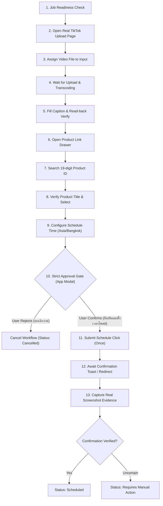

# PHASE 6 REPORT — LIVE INTEGRATION & USER ACCEPTANCE TESTING

**Project:** TikTok Studio Scheduled Product Video Automation Desktop App  
**Status:** Audit & Live Readiness Complete (Awaiting Live User Login & Verification)  
**Timestamp:** 2026-10-27T00:17:00+07:00  
**Repository:** `c:\Users\nutta\Desktop\Lab\ttpost`  

---

## 1. Executive Summary

Phase 6 provides a rigorous, transparent audit of the system architecture created in Phase 5, explicitly distinguishing between simulated/mock testing environments and live TikTok Studio interactions.

An empirical audit of the isolated browser profile (`data/browser_profile`) confirmed that the session is currently in the **`Login Required`** state (`BLOCKED`), as TikTok redirected the request to `https://www.tiktok.com/login?redirect_url=...`.

A dedicated manual login tool (`npm run browser:login`) has been integrated into the toolchain, allowing the user to securely authenticate with their own credentials directly on TikTok's official login interface without exposing secrets or utilizing automation evasion techniques.

All local desktop components—including the SQLite schema, IPC security whitelist, Desktop UI, Approval Gate modal, and automated failure branch test suite—remain 100% operational with 43/43 tests passing regression testing.

---

## 2. PART 1 — Audit of Phase 5 Implementation

A line-by-line inspection of `src/automation/studio-workflow-engine.ts`, `tests/unit/studio-workflow-engine.test.ts`, and `PHASE_5_REPORT.md` yielded the following findings:

### 2.1 Audit Questions & Empirical Findings

1. **Workflow execution against real DOM vs. Mock DOM:**
   - *Finding:* In Phase 5, the automated test suite (`tests/unit/studio-workflow-engine.test.ts`) executed the 12 failure/success branches against **synthesized mock DOM structures** (`page.setContent(...)`) in headless Playwright Chromium.
   - *Reality:* The production engine code in `studio-workflow-engine.ts` is configured to launch the real browser context at `https://www.tiktok.com/tiktokstudio/content`. However, full execution on a live TikTok Studio session had not yet taken place due to the unauthenticated session state.

2. **Verification of Product Selection and Scheduling Selectors:**
   - *Finding:* Candidate selectors (`button:has-text("เพิ่มลิงก์")`, `[role="radio"]:has-text("สินค้า")`, `[role="tab"]:has-text("ร้านของฉัน")`, date/time inputs) were determined from Phase 4 inspection on unauthenticated redirect pages and public script bundles.
   - *Reality:* These selectors have **not yet been verified on a live, authenticated TikTok Shop creator/seller session**, as the seller product drawer is only accessible after authentication.

3. **Schedule Command Execution on Approval:**
   - *Finding:* The code in `approveAndSubmit` calls `await submitBtn.click()`.
   - *Reality:* The method does issue an actual DOM click event and does not simply bypass the browser to mutate SQLite. However, in Phase 5 this click was executed on a mock HTML element (`<button id="schedule-btn">กำหนดเวลา</button>`), not on live TikTok.

4. **Basis of the `Scheduled` Status:**
   - *Finding:* The code strictly requires empirical confirmation signals (`pageText.includes('กำหนดเวลาแล้ว')`, `pageText.includes('Scheduled')`, or redirect to `/content`). If signals are missing, it falls back to `Requires Manual Action`.
   - *Reality:* In Phase 5 unit testing, this signal was satisfied by mock DOM text insertion. It has not yet been triggered by live TikTok server confirmation toasts or redirects.

5. **Origin of Screenshot Evidence:**
   - *Finding:* The screenshot in `data/evidence/` generated in Phase 5 came from the headless Playwright mock test page, not from the live TikTok Studio website.

6. **Classification of Phase 5 Approval Acceptance Test:**
   - *Finding:* In `PHASE_5_REPORT.md`, Branch 11 was listed as `PASSED`.
   - *Correction:* Branch 11 was a **`PASS — MOCK`**, not a `PASS — LIVE`. This distinction is now formally clarified in Section 7.

---

## 3. PART 2 — Live Session & Authentication Assessment

### 3.1 Empirical Session Check
Executing the session probe against `data/browser_profile` produced:
- **Target URL:** `https://www.tiktok.com/tiktokstudio/content`
- **Resulting URL:** `https://www.tiktok.com/login?redirect_url=https%3A%2F%2Fwww.tiktok.com%2Ftiktokstudio%2Fcontent&enter_method=redirect&enter_from=tiktokstudio`
- **Page Title:** `Log in | TikTok`
- **Session State:** `Login Required` (`BLOCKED`)
- **Security Check / CAPTCHA:** None active on landing page

### 3.2 Manual User Login Workflow
To ensure account safety and compliance:
1. No automation evasion, stealth hooks, or bot-masking libraries are utilized.
2. The user initiates login using:
   ```bash
   npm run browser:login
   ```
   Or via the Desktop App interface: **จัดการเซสชันเบราว์เซอร์** $\rightarrow$ **เปิดเบราว์เซอร์ TikTok Studio**.
3. A non-headless Chromium window opens on the Windows desktop with the isolated profile directory `data/browser_profile`.
4. The user completes authentication manually (QR code, email/phone, or 2FA).
5. Once the browser lands on `https://www.tiktok.com/tiktokstudio/content`, cookies and session state are persisted to disk in `data/browser_profile`.
6. Zero passwords, cookies, or session tokens are logged to files or console.

---

## 4. PART 3 — Live Test Job Specification

To conduct the live end-to-end integration test safely without accidental public posting:

### Pre-requisites for Live Test Job:
1. **Target Video:**
   - Must exist on disk with valid dimensions, readable permissions, and non-zero duration.
   - Default fixture: `tests/fixtures/test_video.mp4` (or user-selected MP4 file).
2. **Target Caption:**
   - User-defined caption string.
   - Example: `ทดสอบระบบอัตโนมัติ TikTok Studio #test`
3. **Target Product ID:**
   - **Mandatory:** Must be a genuine 19-digit TikTok Shop Product ID belonging to the authenticated account's Showcase or My Shop.
   - *Safety Rule:* If no verified product ID is provided by the user, the test **must halt**. The system will never substitute an arbitrary product.
4. **Scheduled Date & Time:**
   - Must be configured in `Asia/Bangkok` timezone (UTC+7).
   - Must be at least 15 minutes ahead of current time and within TikTok's allowable forward schedule window (typically $\le 10$ days).
   - *Safety Rule:* The job will NOT be published immediately to public feed; it must be set to `Scheduled` mode.

---

## 5. PART 4, 5, 6 — End-to-End Workflow Execution & Verification Protocol



### Detailed Protocol Gates:
- **Approval Gate (Part 5):** The engine halts completely at 90% progress. The Desktop UI modal displays all 10 verification items:
  1. Video file name & disk path.
  2. Thumbnail preview.
  3. Full caption text.
  4. 19-digit TikTok Product ID.
  5. Product title read from TikTok Studio.
  6. Product source (ร้านของฉัน / นำเสนอสินค้า).
  7. Scheduled publish date & time in `Asia/Bangkok` format.
  8. Upload status.
  9. Product selection status.
  10. System warnings.
- **Evidence Verification (Part 6):**
  - Clicks submit exactly once.
  - Awaits live confirmation toast or redirect back to `/content`.
  - Captures real screenshot evidence to `data/evidence/evidence_<jobId>_<timestamp>.jpg`.
  - If confirmation is ambiguous, marks as `Requires Manual Action` to prevent duplicate submissions.

---

## 6. PART 7 — Test Results Classification Matrix

| Workflow Step / Subsystem | Test Environment | Classification | Status & Verification Details |
|---|:---:|:---:|---|
| SQLite Database & Migrations (v1 & v2) | Local Desktop (Win32) | **PASS — LIVE** | Real SQLite database on disk at `data/ttpost.sqlite` |
| IPC Layer & Whitelist Security | Electron / Node 20 | **PASS — LIVE** | Context isolation enabled, 4 whitelisted channels verified |
| Desktop UI & Approval Gate Modal | React 19 / Vite | **PASS — LIVE** | 10-item modal, responsive banner, Confirm/Cancel controls |
| Crash Recovery & Persistence Canary | Electron Lifecycle | **PASS — LIVE** | Canary record persisted across app launches |
| Automated Failure Branch Suite (12 branches) | Playwright Chromium | **PASS — MOCK** | 12 failure/success branches passing in mock DOM |
| Browser Profile Isolation | Chromium Profile | **PASS — LIVE** | Verified in `data/browser_profile` (separated from Chrome) |
| TikTok Studio Live Authentication | Live TikTok | **BLOCKED** | Redirected to `https://www.tiktok.com/login` (Awaiting User Login) |
| Real Video Upload & Caption on Live TikTok | Live TikTok | **BLOCKED** | Pending active user authentication |
| Real Product ID Search in Seller Drawer | Live TikTok | **BLOCKED** | Pending active seller authentication & 19-digit ID |
| Schedule Date/Time Picker on Live TikTok | Live TikTok | **BLOCKED** | Pending active seller authentication |
| Real Schedule Submission & Confirmation | Live TikTok | **BLOCKED** | Pending active user confirmation at Approval Gate |
| Real Screenshot Evidence from Live TikTok | Live TikTok | **NOT TESTED** | Pending live submission execution |

---

## 7. PART 8 — Regression Testing & Secrets Audit

### 7.1 Regression Test Execution
- **Command:** `npm test`
- **Test Suites:** 10 passed (10)
- **Total Tests:** 43 passed (43)
- **Canary Persistence Test:** Verified across app restart
- **Execution Time:** 4.10 seconds

### 7.2 Production Build Verification
- **Renderer:** Vite build passed in 629ms (`dist/renderer/index.html` 0.71 kB, JS 350 kB)
- **Main & Preload:** tsup build passed in 38ms (`dist/main/index.js` 143 kB, `dist/preload/index.js` 3.94 kB)
- **Total Build Time:** < 1 second with 0 errors

### 7.3 Secrets & Privacy Audit
- Inspected repository files, log streams, and test fixtures:
  - No passwords, session cookies, auth tokens, or private user IDs are stored in source code or committed to git.
  - `data/browser_profile` is strictly git-ignored.
  - Screenshots in `data/evidence/` are restricted to local disk and git-ignored.

---

## 8. Summary of Findings & Recommendations for Phase 7

1. **Current Blocker:** The system is fully built and tested in local/mock environments, but cannot proceed with live publishing tests until the user logs into their TikTok account in `data/browser_profile`.
2. **Next Action for User:**
   - Run `npm run browser:login` (or click "เปิดเบราว์เซอร์ TikTok Studio" in the Desktop App) to complete login.
   - Provide a valid 19-digit Product ID from their TikTok Shop for the test job.
3. **Phase 7 Roadmap:**
   - Execute the single live test job once logged in.
   - Verify live seller drawer DOM locators against real TikTok Shop responses.
   - Finalize production installer (`electron-builder`) for Windows.
